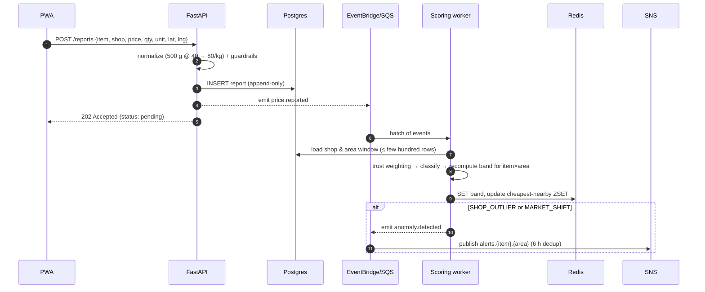
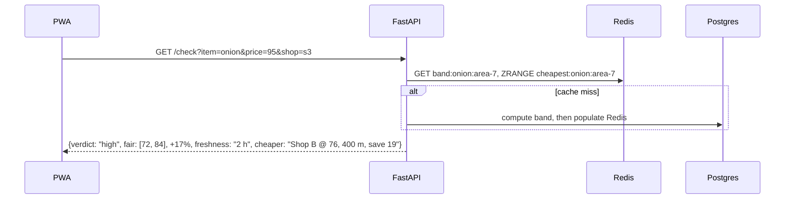
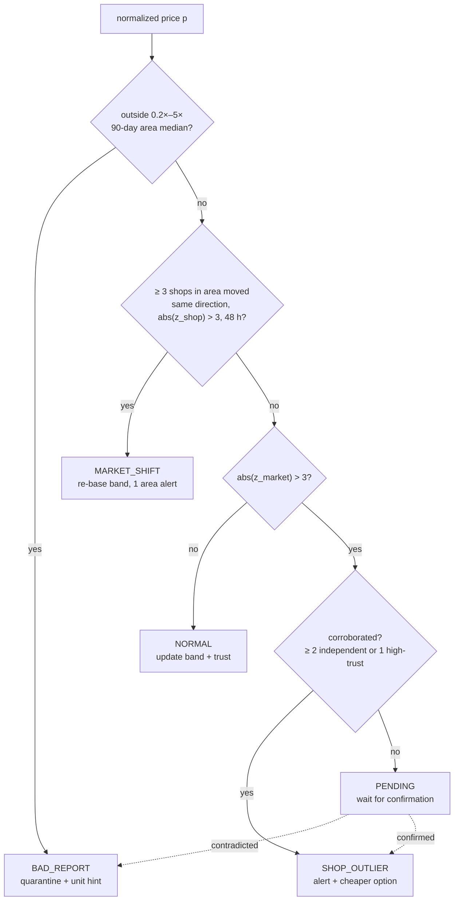

# Smart Pricing Monitor — Architecture

> **Visual diagram:** open [`architecture.html`](./architecture.html) in a browser. It supports light and dark mode.
> The Mermaid diagrams below show the same design and render directly on GitHub.

## 1. Problem and positioning

People compare grocery prices across shops without knowing whether the price they've been quoted is reasonable.
Most price trackers show a list of past prices. This system is built to answer one question quickly and honestly:

> **"Is the price I'm being quoted right now fair, and where could I get it cheaper?"**

To answer it, the system has to work out *why* a price looks unusual before it alerts anyone:

| Cause | Example | What we do |
|---|---|---|
| The **report** is wrong | someone entered the 500 g price as the per-kg price | quarantine it, suggest a unit fix, lower the reporter's trust |
| The **shop** is out of line | Shop X charges 40% above every other nearby shop | alert subscribers and suggest a cheaper verified shop |
| The **market** moved | onion prices rise everywhere after a supply shock | re-base the fair band and send one area-wide alert, without flagging every shop |

## 2. What makes it different (badges A–G in the diagram)

| # | Differentiator | Typical tracker |
|---|---|---|
| **A** | **Fair-price verdict**: `fair / high / suspicious` plus confidence, freshness and the cheapest verified alternative | shows a table and leaves the judgement to you |
| **B** | **Unit normalization**: everything is converted to a base unit (per kg, per dozen, per litre); local names map to one product | compares raw numbers, so pack-size differences look like price changes |
| **C** | **Guardrails at ingest**: geo-fence (≤ 300 m of the shop), dedupe, burst limits, sanity bounds, "did you mean ×2?" hints | accepts everything |
| **D** | **Trust-weighted consensus**: Beta(α, β) reporter reputation; a price is VERIFIED after ≥ 2 independent reports | one user, one vote; the last report wins |
| **E** | **3-way anomaly classifier**: BAD_REPORT vs SHOP_OUTLIER vs MARKET_SHIFT, using robust statistics | a single threshold: market moves flag every shop and bad data gets through |
| **F** | **Freshness decay**: report weight halves at an item-specific half-life; stale data is labelled as stale | an old price looks the same as today's |
| **G** | **Event-driven and cache-first**: constant-time write path, async scoring, O(1) reads from Redis | aggregate SQL on every page view |

## 3. Component diagram

```mermaid
flowchart LR
  subgraph C[1 · Client]
    PWA["React PWA<br/>offline-first<br/>① Price Check ② Report ③ Compare"]
    INBOX[Alerts inbox]
  end
  subgraph E[2 · Edge & API]
    GW[API Gateway<br/>JWT · throttling · WAF]
    API[FastAPI on Lambda<br/>Mangum]
  end
  subgraph I[3 · Ingest - sync]
    NORM[Normalizer<br/>units + aliases]
    GUARD[Guardrails<br/>geo-fence · dedupe · bounds]
  end
  subgraph D[4 · Data]
    REDIS[(Redis<br/>fair bands · cheapest ZSET)]
    PG[(PostgreSQL + PostGIS<br/>append-only reports)]
    S3[(S3 - optional<br/>receipts)]
  end
  subgraph X[5 · Intelligence - async]
    WORKER[Scoring worker<br/>SQS batch + DLQ]
    TRUST[Trust engine<br/>Beta reputation]
    ANOM[Anomaly classifier<br/>3-way, robust z]
    BAND[Fair-price band<br/>freshness-weighted]
  end
  subgraph O[6 · Delivery & Ops]
    SCHED[EventBridge Scheduler]
    DIGEST[Daily digest Lambda]
    SNS[SNS alerts.item.area]
    CW[CloudWatch metrics]
  end
  BUS{{EventBridge bus<br/>price.reported · anomaly.detected · band.updated}}

  PWA -->|HTTPS| GW --> API
  API -->|write| NORM --> GUARD -->|INSERT| PG
  API -->|read, cache-aside| REDIS
  GUARD -. price.reported .-> BUS
  BUS -. SQS .-> WORKER --> ANOM
  ANOM <--> TRUST --> BAND -->|SET| REDIS
  ANOM <-->|history / anomalies| PG
  WORKER -. anomaly.detected .-> BUS
  BUS -.-> SNS
  SCHED --> DIGEST --> SNS
  SNS ==>|push / email| INBOX
```

## 4. Hot paths

### Report a price (write path: cheap and synchronous, heavy work async)



### Check a quote (read path: served from Redis)



## 5. Anomaly logic (no ML infrastructure needed for the MVP)

Robust z-score: `z = (p − median) / (1.4826 · MAD)`. Median and MAD tolerate bad reports far better than mean and standard deviation do.



**Trust:** `reputation = α / (α + β)`, where α = 1 + confirmed reports and β = 1 + contradicted reports. New users start at 0.5.

**Freshness weight:** `w = trust × 0.5^(age / half_life)`. The half-life is derived from each item's historical volatility, roughly 2 days for onions and tomatoes and 14 days for rice or sugar. The fair band is the weighted P25–P75 range. If the total weight falls below a threshold, the verdict is `unknown (stale)`.

**Upgrade path:** once there is enough history, add a seasonal baseline (STL/Prophet) or an Isolation Forest via SageMaker. It plugs in behind the same classifier interface.

## 6. Why it is efficient

1. **The write path is constant-time.** Normalize, guard, insert and emit take a handful of milliseconds; everything expensive runs asynchronously.
2. **Recomputation is incremental.** Each event recomputes only its own `item × area` window, never the whole dataset.
3. **Reads are precomputed.** `/check` and `/compare` read Redis keys. Postgres handles writes and cache misses only.
4. **Robust statistics instead of a model server.** Median and MAD over a few hundred rows cost microseconds, with no GPU, endpoint or training pipeline.
5. **Serverless and event-driven.** Lambda, API Gateway, EventBridge, SQS and SNS scale to zero; only Postgres and Redis run all the time. SQS absorbs bursts and the DLQ catches poison messages.
6. **Append-only, month-partitioned reports.** No update contention, a full audit trail, and cheap archiving of old partitions to S3.
7. **No duplicate alerts.** A 6-hour dedup window per `item × area` topic and one alert per MARKET_SHIFT, instead of N shop alerts.

## 7. Key decisions

| Decision | Choice | Why |
|---|---|---|
| Primary store | **PostgreSQL + PostGIS** (not DynamoDB) | "Nearby shops" is a geo query, and medians or cross-shop comparisons are relational and analytical. DynamoDB would need every access pattern precomputed. |
| Hot layer | **Redis** | O(1) bands, sorted sets for "cheapest nearby", TTL for freshness, rate-limit counters |
| API | **FastAPI on Lambda via Mangum** | The same code runs locally in Docker and on AWS |
| Async | **EventBridge → SQS → Lambda** | Fan-out on the bus; SQS adds batching, retries and a DLQ |
| Anomaly detection | **Robust statistics first, ML later** | Works with very little data, is explainable to users, and has no infrastructure cost |
| Code layout | **Ports and adapters** | The domain logic (normalize, trust, classify, band) is pure Python, and the event bus and storage are swappable adapters |

### Local vs AWS mapping

| Concern | Local dev (docker-compose) | AWS |
|---|---|---|
| API | uvicorn + FastAPI | API Gateway + Lambda (Mangum) |
| DB | postgis/postgis container | RDS PostgreSQL + PostGIS |
| Cache | redis container | ElastiCache Redis |
| Event bus | Redis Streams adapter | EventBridge + SQS |
| Alerts | console/email adapter | SNS |
| Scheduler | APScheduler | EventBridge Scheduler |

## 8. MVP scope

- **10 products:** onion, potato, rice, eggs, tomato, lentils, cooking oil, sugar, flour, milk
- **5 shops** in one area, with geo-coordinates
- **Endpoints:** `POST /reports`, `GET /check`, `GET /compare`, `GET /trends/{item}`, `POST /subscriptions`
- **Success metrics** (CloudWatch dashboard):
  - *price gaps detected*: SHOP_OUTLIER and MARKET_SHIFT counts per week
  - *freshness*: median report age per item, and % of items with data newer than one half-life
  - *potential savings*: Σ (quoted price − cheapest verified nearby price) across `/check` calls
  - *data quality*: % of reports quarantined, and the precision of PENDING → confirmed
